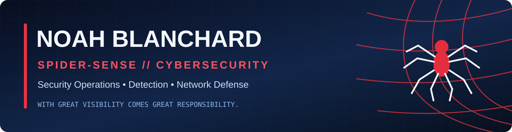

**SECURITY+ CERTIFIED** · **SOC / BLUE TEAM** · **PYTHON + LINUX**

 

# Noah Blanchard | Cybersecurity & Security Operations

**Cybersecurity Systems B.S. candidate · St. John's University · Expected December 2026**

CompTIA Security+ certified | Google Cybersecurity Professional Certificate | Building practical experience in security operations, network monitoring, incident investigation, and Linux.

**Seeking entry-level SOC, IT support, and security roles in the New York City area.**

I build and document security labs to understand not only **what triggered an alert**, but also **what evidence supports a finding, what remains unknown, and how monitoring can improve**. My interests include SOC analysis, detection engineering, incident response, and security risk.

## Featured work

| Project | What I built / practiced | Evidence |
| --- | --- | --- |
| [Spider-Sense SOC](https://github.com/noahblanny/spider-sense-soc) | Proxmox-hosted Wazuh server, Suricata sensor, endpoint telemetry, dashboards, and investigation workflow | [Architecture](https://github.com/noahblanny/spider-sense-soc/blob/main/architecture/architecture.md) · [Investigation 001](https://github.com/noahblanny/spider-sense-soc/blob/main/investigations/001-listening-port-changes.md) |
| **SpiderNet network inventory** | Python + SQLite device discovery and inventory of IP, MAC, hostname, and status; developed to improve home-network visibility | [Project summary](projects/spidernet.md) |
| [Automated trading bot](https://github.com/noahblanny/trading-bot) | Flask webhook service that routes TradingView RSI alerts through Claude and hard-coded risk limits to Alpaca; ran on Railway (hosting currently paused); pytest + CI | [README with safety limits and documented gaps](https://github.com/noahblanny/trading-bot#known-gaps) |
| **Cowrie honeypot** | Deployed an SSH/Telnet honeypot in a controlled lab to study connection and authentication activity | [Project summary](projects/cowrie-honeypot.md) |
| [Java cryptanalysis](https://github.com/noahblanny/Cryptoanalysis_Programming) | Coursework implementation exploring classical cipher analysis | [Source code](https://github.com/noahblanny/Cryptoanalysis_Programming) |
| **Network forensics & traffic analysis** | Wireshark/tcpdump packet inspection, protocol analysis, and investigation write-ups | [Project summary](projects/network-forensics.md) |
| **Firewall and traffic control** | Configured and verified Linux UFW/iptables rules | [Project summary](projects/firewall-traffic-control.md) |
| **Python traffic simulation** | Simulated traffic, threshold alerts, and anomaly-oriented analysis using Python and Plotly | [Project summary](projects/traffic-simulation.md) |
| **Active Directory practice lab** | Windows Server/workstation lab for hands-on PNPT learning; setup and exercises ongoing | [Lab status](projects/active-directory-lab.md) |

> **Portfolio note:** Project summaries describe work completed in labs or coursework. A summary is not a claim that source code, sanitized datasets, or reproducible deployments have been published. Where available, source code and investigation artifacts are linked explicitly.

## Technical toolkit

- **Detection & investigation:** Wazuh, Suricata, Splunk, Wireshark, tcpdump, Snort
- **Systems & networks:** Linux, Windows, macOS, Proxmox, TCP/IP, DNS, DHCP, VLANs, firewalls
- **Security testing (authorized labs):** Nmap, Burp Suite, Metasploit, Netcat
- **Programming & data:** Python, Java, SQL, SQLite, Git/GitHub
- **Security practice:** incident triage, log analysis, network forensics, access control, risk assessment

## Experience & learning

- **Cybersecurity Intern — Holy Cross High School (Summer 2026):** Windows and Google Workspace support, endpoint troubleshooting, network diagnostics, and risk assessment documentation.
- **CompTIA Security+ (SY0-701)** — Earned October 2026.
- **Google Cybersecurity Professional Certificate** — Completed October 2025.
- **Core Security Training Certificate** — St. John's University, October 2025.
- **PNPT training** — In progress; practicing enumeration, exploitation in authorized labs, and Active Directory concepts.

## Currently improving

- Better alert context and historical process/network telemetry in Spider-Sense
- More reproducible, sanitized configurations and scripts
- Structured investigation reports with evidence, limitations, and remediation

**Explore the [Spider-Sense SOC](https://github.com/noahblanny/spider-sense-soc) repository first** for the most complete architecture, screenshots, and investigation evidence in this portfolio.
